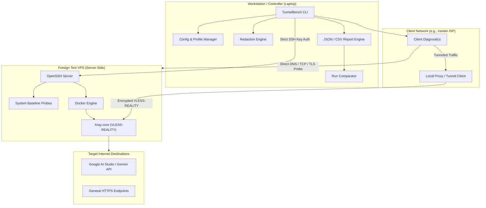

# TunnelBench System Architecture

**Version:** 0.1.0  
**Document Status:** Approved Architecture  

---

## 1. High-Level Architecture Overview

TunnelBench follows an **agentless, laptop-controlled architecture**. The user's workstation or laptop acts as the central orchestrator, executing diagnostics, provisioning test tunnels, directing client verification runs, and synthesizing structured comparison reports.

---

## 2. Core Subsystems & Modular Boundaries

### 2.1 Configuration & Profile Management (`tunnelbench.config`)
- Stores named foreign VPS profiles in `~/.config/tunnelbench/profiles.json`.
- **Zero-Secret Storage:** Profiles record hostnames, IP addresses, SSH ports, SSH usernames, and SSH key file paths or SSH agent flags. Passwords, private keys, and UUIDs are NEVER written to configuration files.
- Input validation: Hostnames and IPs undergo strict regex and RFC-compliant syntax verification before storage.

### 2.2 Centralized Secret Redaction Engine (`tunnelbench.redaction`)
- Intercepts all output strings, logs, exceptions, and serialization dictionaries prior to display or disk persistence.
- Masked entities include:
  - VLESS / Xray UUIDs (`xxxxxxxx-xxxx-4xxx-yxxx-xxxxxxxxxxxx` -> `[REDACTED_UUID]`)
  - Cryptographic private/public keys (Curve25519, Ed25519, RSA, PEM blocks)
  - API keys (e.g., Google `AIzaSy...`, bearer tokens)
  - Full client connection URIs containing keys (`vless://...`)
  - Optional IPv4 / IPv6 obfuscation for privacy preservation

### 2.3 Remote SSH Client (`tunnelbench.remote.ssh`)
- Built upon OpenSSH subprocess calls (`/usr/bin/ssh`) with programmatic argument lists (`argv`), completely eliminating shell interpolation vulnerabilities.
- **Strict Host Key Checking:** Configured by default with `-o StrictHostKeyChecking=yes`. Bypassing or disabling host key checks is strictly prevented.
- Timeouts and Output Quotas: Enforces bounded wall-clock timeouts and max output buffers to avoid hung connections and memory exhaustion.

### 2.4 Diagnostic Core (`tunnelbench.diagnostics`)
- **Preflight (`preflight.py`):** Inspects host platform, Python version (>=3.11), OpenSSH client availability, Docker availability, and report output directory permissions.
- **Foreign VPS Baseline (`baseline.py`):** Runs read-only diagnostic commands over SSH:
  - System architecture (`uname -m`), kernel release, OS release (`/etc/os-release`).
  - Available CPU cores, RAM utilization (`/proc/meminfo`), disk partition capacity (`df -h`).
  - Network interfaces and default routing table (`ip -j route` or `netstat`).
  - Outbound DNS resolution and HTTPS ping to global reference endpoints.

### 2.5 Protocol Adapter Subsystem (`tunnelbench.adapters`)
- Abstract base class (`BaseAdapter`) enforcing a rigorous lifecycle:
  1. `check_prerequisites()`
  2. `build_deployment_plan()` (returns human-readable step-by-step diff)
  3. `require_user_approval()` (blocks until explicit confirmation)
  4. `deploy()` (executes containerized or native service startup)
  5. `health_check()` (verifies listening sockets, PID status, error-free logs)
  6. `cleanup()` (removes ONLY the containers and configuration files deployed by TunnelBench)
- **First Reviewed Adapter (`XrayRealityAdapter`):** Deploys official `ghcr.io/xtls/xray-core` container on foreign VPS using VLESS + REALITY + XTLS-Vision.

### 2.6 Validation Engine (`tunnelbench.validation`)
- **Client Network Probes (`client_check.py`):** Executes 7-stage diagnostic ladder from the client:
  1. Local DNS resolution vs Bogon detection (`10.10.34.0/24`).
  2. TCP 3-way handshake reachability to VPS port.
  3. TLS ClientHello negotiation check.
  4. Local proxy socket readiness.
  5. In-tunnel HTTP/HTTPS request check.
  6. Direct vs tunneled latency comparison.
- **Target Service Probes (`target_check.py`):** Tests specific application endpoints (Google AI Studio / Gemini API), distinguishing network-level blocking from API credential errors and geographical restrictions.

### 2.7 Reporting & Comparison Engine (`tunnelbench.reporting`, `tunnelbench.comparison`)
- Emits structured JSON conforming to `TunnelBenchReport_v1` specification.
- Generates granular CSV exports where each row represents an individual test probe or attempt, facilitating tabular analysis in tools such as Excel, Google Sheets, or Pandas.
- Run comparator computes delta metrics between two test runs (latency changes, packet loss differences, error classification shifts).
